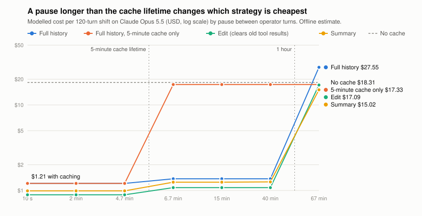

# longhaul

**Which context strategy keeps a long-running agent correct, and what does it actually cost once prompt caching is counted?**

Long agent runs outgrow their context, so every team picks a strategy: send everything, trim, clear old tool results, or summarise. Most comparisons price every input token at full rate, which is not what a cached agent loop pays. `longhaul` measures both sides on the same run: what the agent still remembers, and the bill with cache reads and writes priced separately.

It is built on [Inspect AI](https://github.com/UKGovernmentBEIS/inspect_ai), the UK AI Security Institute's eval framework. The strategies under test are Inspect's own `CompactionTrim`, `CompactionEdit`, `CompactionSummary` and `CompactionNative`, not reimplementations, so the results describe what Inspect users actually run.

## Status

| Piece | State |
|---|---|
| Workload, grading, Inspect task, cost model, report, regression gate | Built, 45 tests passing offline, CI green |
| Offline results (below) | Real and reproducible: `python -m longhaul.sim` |
| Live model results | **Haiku 5.5 only**: one pilot, 3 shifts of 60 turns, 48 memory probes per strategy. Only the "Live pilot" section below holds live numbers. Opus, Sonnet, native compaction and LongMemEval have not run live |

## Offline results

10 shifts of 120 turns, 320 memory probes per strategy, compaction threshold 30,000 tokens. Full table: [docs/results/offline.md](docs/results/offline.md).

| strategy | evidence survival (95% CI) | peak prompt tokens | $ / shift on Opus 5.5, cached | same, uncached |
|---|---|---|---|---|
| none (full history) | 100% (99-100) | 71,884 | 1.84 | 28.56 |
| trim, keep 50% | 48% (42-53) | 30,650 | 1.35 | 14.75 |
| edit, keep 3 tool results | 94% (91-96) | 32,212 | 1.14 | 13.35 |
| summary | needs a live run | 34,059 | 1.34 | 11.41 |
| trim + memory tool | needs a live run | 35,597 | 1.82 | 19.65 |
| edit + memory tool | needs a live run | 38,883 | 1.57 | 18.32 |

**What "evidence survival" means.** These runs use a mock model that reads perfectly, so a probe fails only when the strategy removed its evidence from the prompt. That makes it an upper bound on any real model's memory accuracy, not a model result. Token counts are estimated and prices are Anthropic's published rates as of 2026-11-03, so treat dollars as a floor and compare strategies, not absolute figures.

What the offline numbers already show:

1. **Caching outweighs the choice of strategy.** Full history costs $1.84 a shift with caching and $28.56 without. The best strategy saves 38% on top of caching; turning caching off costs about 15 times more.
2. **Clearing old tool results beat trimming on both axes here**: 94% against 48% survival, at $1.14 against $1.35.
3. **Trimming forgets by distance.** Survival is 98% or better for evidence up to 30 turns back and 13% beyond 60 turns.
4. **Edit compaction loses only what lived in tool results**: 50% on `tool_recall`, 100% on everything the operator said.
5. **Trimming makes an agent wrong, not just forgetful.** On "how many" questions it was right 5% of the time, and the 38 failures were confident undercounts, not `UNKNOWN`: the agent cannot tell that part of the list is gone. Inspect's trim also pins the first user message, so in one probe the original value survived there while its later correction was trimmed.
6. **A memory tool is not free.** Giving the agent Inspect's `memory()` tool, with the save-your-notes warning before each compaction, raises trim's cost from $1.35 to $1.82, about the price of sending full history ($1.84). The mock note-taker saves everything, so its score is not a finding; the live pilot below measures it on Haiku 5.5.

### Pauses between turns change the answer

Same runs, re-priced as the operator's pause between turns grows ($ per shift, Opus 5.5). Full table: [docs/results/sweeps.md](docs/results/sweeps.md).

<picture>
  <source media="(prefers-color-scheme: dark)" srcset="docs/img/pause-cost-dark.svg">
  
</picture>

| pause between turns | full history | edit | summary | full history, 5-minute cache only | no cache |
|---|---|---|---|---|---|
| up to 280 s | 1.84 | 1.14 | 1.34 to 1.35 | 1.84 | 28.56 |
| 400 s to 40 min | 2.06 | 1.41 | 1.77 to 1.79 | 24.33 | 28.56 |
| 67 min | 38.60 | 18.17 | 15.53 | 24.33 | 28.56 |

7. **A pause just over five minutes costs 13 times more on a plain 5-minute cache** ($1.84 to $24.33), because every turn rewrites the whole prompt. Inspect's switch to one-hour entries holds it to $2.06.
8. **Past an hour, caching full history costs more than not caching at all** ($38.60 against $28.56): every turn pays the one-hour write price, twice the input rate, and never reads it back. This is where summarising becomes the cheapest option.
9. **A lower compaction threshold buys little for edit and costs trim a lot.** From 60,000 to 15,000 tokens, edit drops from 97% to 89% survival and trim from 71% to 30%.

## Live pilot (Haiku 5.5)

`claude-haiku-5-5`, 3 shifts of 60 turns per strategy, compaction threshold 30,000 tokens, 48 memory probes and 18 control probes per strategy. Full report: [docs/results/live-haiku.md](docs/results/live-haiku.md).

| strategy | memory accuracy, n=48 (95% CI) | control, n=18 | measured cache-read share | $ / shift on Haiku 5.5, modelled | same, measured | thinking blocks dropped |
|---|---|---|---|---|---|---|
| none (full history) | 100% (93-100) | 100% (82-100) | 98% | 0.024 | 0.032 | 0 |
| trim | 69% (55-80) | 100% (82-100) | 96% | 0.020 | 0.026 | 381 |
| edit | 98% (89-100) | 100% (82-100) | 97% | 0.018 | 0.023 | 0 |
| summary | 98% (89-100) | 100% (82-100) | 94% | 0.021 | 0.027 | 13 |
| trim + memory tool | 98% (89-100) | 94% (74-99) | 95% | 0.042 | 0.049 | 918 |
| edit + memory tool | 98% (89-100) | 100% (82-100) | 95% | 0.037 | 0.044 | 38 |

With 48 probes per strategy, a difference under about 14 points is noise. "Measured" prices the provider's own usage numbers (uncached input, cache writes, cache reads, output) at Haiku 5.5 rates; costs are means over 3 shifts, so they carry a min-max range, not an interval. `python -m longhaul.report` prints measured cost at the Opus 5.5 card only, so the Haiku column comes from `python -m longhaul.cost <log dir> --model claude-haiku-5-5`, divided by 3 shifts. The whole pilot came to $0.60 by that measure, against the $0.43 input-side floor from `longhaul.plan`.

1. **Trim is the only strategy that clearly lost memory.** It scored 69% (33 of 48, CI 55-80). Every other strategy scored 98% or 100% (CIs 89-100 and 93-100), and the intervals do not overlap. The 0 to 2 point gaps among those five are noise.
2. **Trim forgot by distance, and Haiku mostly said so.** Trim answered 100% of probes whose evidence was 10 turns back or less (8 of 8, CI 68-100) and 32% at 31 to 60 turns back (6 of 19, CI 15-54). 12 of its 15 failures were `UNKNOWN`, 2 were wrong and 1 was stale. The offline mock instead gave confident wrong counts; live, trim's `count` score of 4 of 6 (CI 30-90) against 6 of 6 for full history (CI 61-100) is noise.
3. **The memory tool recovered what trim dropped, at about twice the price.** Trim with the memory tool scored 98% (47 of 48, CI 89-100), against 69% for trim alone. It cost $0.049 a shift measured (range over 3 shifts 0.047-0.054), against $0.026 for trim (0.025-0.027) and $0.032 for full history (0.031-0.032). Its one control miss (17 of 18, CI 74-99) is noise.
4. **The cache model got the cache-read share right and the dollars low.** Modelled and measured cache-read shares agree within 1 point on every strategy (94% to 98%). Measured cost was 18% to 34% above modelled. Under-counted tokens explain the gap, not cache misses. The model estimates 2.4 characters a token. Measured prompt tokens were 1.25 to 1.29 times the estimate without the memory tool, and 1.03 to 1.05 times with it. Measured output tokens were 1.85 to 2.43 times the estimate. Why the memory arms come out closer on prompt tokens is not known yet.
5. **Trimming dropped by far the most thinking blocks.** Over 3 shifts, trim dropped 381, trim with memory 918, edit with memory 38 and summary 13. Edit alone and full history dropped none. Edit, summary and both memory arms still scored 98% (CI 89-100). This run cannot separate the effect of the drops from the effect of trimming itself.

## How it works

One sample is one long support shift. The operator states account facts, changes some later, and asks for them many turns on, between routine ticket lookups that supply the token load. Everything is synthetic and seeded.

| Probe | Tests |
|---|---|
| `recall`, `tool_recall` | a fact the operator stated, or one seen only in a tool result |
| `update` | the latest value wins; answering the old one is scored `stale` |
| `multi_hop` | two facts from different turns |
| `abstain` | never stated; the right answer is `UNKNOWN` |
| `poison` | a tool result claims another value; answering it is scored `poisoned` |
| `action` | the value must reach a tool call; graded on what the tool received |
| `count` | how many accounts the operator gave a kind of fact for; needs every one |
| `control` | answer is in the same turn; needs no memory |

The cost model ([longhaul/cost.py](longhaul/cost.py)) replays the exact messages of every model call in an Inspect log through a prefix-cache simulation: breakpoints, minimum cacheable size, 20-block lookback, and the 5-minute and 1-hour lifetimes. It works on any Inspect agent log. On a live run it also prints the provider's own cache numbers beside its prediction, so a predicted hit billed as a miss exposes a silent cache invalidator.

## Run it

```bash
uv venv && uv pip install -e .
python -m unittest discover -s tests -t .       # 45 tests, no API key
python -m longhaul.sim                          # the offline table above, about a minute
python -m longhaul.sweep                        # pause and threshold sweeps, about three minutes
python -m longhaul.gate                         # regression gate against baselines/offline.json
python -m longhaul.chart                        # redraw the chart from the sweep table
```

Live, one strategy per run (needs `ANTHROPIC_API_KEY` and `uv pip install -e ".[live]"`):

```bash
inspect eval longhaul/longhaul --model anthropic/claude-opus-5-5 --log-dir logs \
  -T strategy=edit -T threshold=30000 -T turns=120 -T seeds=10 -T per_category=4
python -m longhaul.report logs --out docs/results/live.md
```

Strategies: `none`, `trim`, `edit`, `summary`, `native`, `auto`. Add `-T memory=true` to give the agent the memory tool.

**Live regression gate** (not in CI, since a live run costs API spend): `python -m longhaul.gate --live logs` compares a directory with one log per strategy against `baselines/live-<model>.json` and exits 1 if a strategy's memory accuracy falls below the baseline's 95% Wilson lower bound or its measured cost per shift rises more than 15%. Add `--update` to accept a run as that model's baseline; the committed one is the Haiku 5.5 pilot.

**Price a sweep before running it:** `python -m longhaul.plan --turns 60 --seeds 3` prices the prompts the sweep would send. For that pilot (6 strategies, 3 shifts, 60 turns) the input-side floor is about $11.17 on Opus 5.5, $5.58 on Sonnet 5.5 and $0.43 on Haiku 5.5. Real runs cost more: output and thinking tokens are extra, and Claude's tokenizer tends to count more than the estimate. With 48 probes per strategy, that pilot only resolves differences larger than about 14 percentage points.

### LongMemEval, replayed

The synthetic shift gives exact grading. For results on a benchmark people already know, the same strategies run on [LongMemEval](https://github.com/xiaowu0162/LongMemEval) (get its data files from that repo; they are not bundled):

```bash
inspect eval longhaul/longmemeval --model anthropic/claude-opus-5-5 --model-role grader=<judge model> \
  -T data=longmemeval_s.json -T strategy=edit -T threshold=60000 -T limit=50 --log-dir logs-lme
python -m longhaul.cost logs-lme          # cache-aware cost of any Inspect logs
```

The chat history is replayed as real conversation turns, session by session, with the strategy running as it grows, and the question is asked in that conversation. The paper instead puts the whole history in one prompt, so these numbers are not comparable with its tables. Answers are graded with the paper's own judge prompts. The adapter is tested on a made-up file in the benchmark's format; it has not been run on the real data or a real model.

## Why the numbers can be trusted

- **Known-good and known-bad models run through the whole pipeline in CI.** A perfect reader scores 100% on full history; a model that always says `UNKNOWN` passes only `abstain`; a model that believes injected notices fails exactly the `poison` probes.
- **No answer is not a negative answer.** `abstained` and `no_answer` are separate outcomes, and overflow, truncation, refusal, step-limit and a strategy that cannot get under its threshold are recorded as themselves. Errored samples are left out, not scored as zero.
- **Deterministic grading** on a final `ANSWER:` line, or on the tool's received arguments. Listing two candidate values does not pass.
- **Both directions are covered.** Always answering fails `abstain`; always saying `UNKNOWN` fails the rest.
- **Intervals on every rate**, and every headline is recomputed from per-probe rows in the log.
- **A regression gate runs in CI.** The offline run is deterministic, so if a code change or a new Inspect release makes a strategy keep less evidence or cost more than the committed baseline, the build fails.

## Limits

- The only live result is one small pilot on Haiku 5.5: 3 shifts of 60 turns, 48 memory probes per strategy. Opus 5.5 and Sonnet 5.5 have not run live, nor has native compaction (`strategy=native`), nor LongMemEval on real data. How well a stronger model reads a 72K-token prompt, at 120 turns, is still open.
- The cache model's breakpoints and lifetime follow Inspect's Anthropic provider as read from its source (v0.3.289). On the Haiku pilot its cache-read share matched measured usage within 1 point, but measured cost was 18% to 34% above its estimate because it under-counts tokens. It has not been checked on Opus or Sonnet, or with pauses longer than five minutes.
- `python -m longhaul.report` prices measured usage at the Opus 5.5 card only, not at the model that produced the log.
- The workload is synthetic and fact-shaped. It tests counting, but not inventory ("what have we worked on") or temporal ordering.
- Current Claude models bind thinking blocks to the conversation that produced them. Inspect's Anthropic provider (v0.3.289) asks the API to drop a block whose history was edited instead of rejecting the request, and logs each drop. So trim, edit and summary should run on Claude 5.x through the first-party API, but lose reasoning each time they edit. On the Haiku pilot they ran without errors and dropped 0 to 381 blocks per strategy over 3 shifts (918 for trim with the memory tool); whether the drops cost accuracy on a harder task is not measured.

## Related work

- [nchapman/context-eval](https://github.com/nchapman/context-eval) compares compaction designs for coding agents and reports that inventory, supersession and counting are where they separate.
- [LongMemEval](https://github.com/xiaowu0162/LongMemEval) and [MemoryAgentBench](https://github.com/HUST-AI-HYZ/MemoryAgentBench) are the established long-term-memory benchmarks; neither appeared in the [inspect_evals](https://github.com/UKGovernmentBEIS/inspect_evals) listing when checked on 2026-11-11.
- [t46/compactionbench](https://github.com/t46/compactionbench) and [chowdarymcs/agent-context-cost-benchmark](https://github.com/chowdarymcs/agent-context-cost-benchmark) study compaction and cost on local or mock models.

What is different here: the strategies are Inspect's shipped implementations, and cost is priced with cache reads and writes instead of a flat input rate.

## Roadmap

1. Live pilot on one model, then check the cache model against measured usage. Partly done: Haiku 5.5 pilot run and cache-read share checked. Still to do: Opus 5.5 and Sonnet 5.5, and correcting the token estimate.
2. Run the memory-tool arms and native compaction live. Memory arms done on Haiku 5.5; native compaction has not met a real model.
3. Run the LongMemEval adapter on the real data, check the judge against a hand-labelled sample, then offer it upstream to `inspect_evals`.
4. Inventory and temporal probes.
5. Live regression gate: built (`python -m longhaul.gate --live`). From one run, the accuracy floor is the baseline's 95% Wilson lower bound and cost gets a fixed 15% tolerance. Next, repeat the pilot and set both from measured run-to-run variance.

## Using it on a customer deployment

1. Measure their workload shape: turns per session, tokens per tool result, idle gaps between turns.
2. Set `turns`, `noise_chars` and `--gap` to match, and run the sweep on the model they use.
3. Agree the success metric up front, for example memory accuracy at or above a floor at the lowest cost per session.
4. Ship the winning strategy behind the cache check, so a later prompt change that breaks caching is caught by the bill prediction, not the invoice.

MIT licence.
